<p align="center">
  
</p>

<p align="center">
  <a href="https://agegnehuy.github.io/portfolioo/"></a>
  <a href="https://agegnehuy.github.io/portfolioo/"></a>
  <a href="https://github.com/agegnehuy?tab=followers"></a>
</p>

## About me

I’m a full-stack developer who enjoys taking an idea from the first sketch to a polished, working product. My work spans immersive web experiences, practical developer tools, mobile apps, and games. I care about interfaces that feel alive, systems that stay maintainable, and software that solves a real problem.

```ts
const agegnehu = {
  focus: ["full-stack products", "creative web experiences", "developer tools"],
  currentlyBuilding: "useful software with thoughtful interfaces",
  values: ["craft", "curiosity", "continuous learning"],
  openTo: "collaboration and ambitious ideas",
};
```

## Selected work

<table>
  <tr>
    <td width="50%" valign="top">
      <h3><a href="https://github.com/agegnehuy/portfolioo">◈ Interactive Portfolio</a></h3>
      <p>A responsive portfolio and content platform with an immersive Three.js hero, project case studies, and a Supabase-powered admin experience.</p>
      <p><code>React</code> <code>Vite</code> <code>Three.js</code> <code>Supabase</code></p>
      <a href="https://agegnehuy.github.io/portfolioo/">Live site →</a>
    </td>
    <td width="50%" valign="top">
      <h3><a href="https://github.com/agegnehuy/kidy-excel-mcp">◈ Kidy Excel MCP</a></h3>
      <p>A cross-platform Model Context Protocol server that lets AI clients inspect, analyze, and update Excel workbooks.</p>
      <p><code>TypeScript</code> <code>MCP</code> <code>Excel</code> <code>Zod</code></p>
      <a href="https://github.com/agegnehuy/kidy-excel-mcp">Explore the server →</a>
    </td>
  </tr>
  <tr>
    <td width="50%" valign="top">
      <h3><a href="https://github.com/agegnehuy/qr-code-generator">◈ QR Code Generator</a></h3>
      <p>A production-ready QR code generator built for a fast, focused, and type-safe creation experience.</p>
      <p><code>Next.js</code> <code>TypeScript</code> <code>Tailwind CSS</code></p>
      <a href="https://github.com/agegnehuy/qr-code-generator">View the project →</a>
    </td>
    <td width="50%" valign="top">
      <h3><a href="https://github.com/agegnehuy/Amazing_Game">◈ Amazing Game</a></h3>
      <p>A Unity game project exploring interactive systems, gameplay mechanics, and real-time experiences.</p>
      <p><code>Unity</code> <code>C#</code> <code>Game Development</code></p>
      <a href="https://github.com/agegnehuy/Amazing_Game">See the game project →</a>
    </td>
  </tr>
</table>

## Toolbox

<p align="center">
  
</p>

## GitHub snapshot

<p align="center">
  
  
</p>

---

<p align="center">
  <strong>Have an idea worth building?</strong><br />
  <a href="https://agegnehuy.github.io/portfolioo/">Let’s make it real.</a>
</p>
